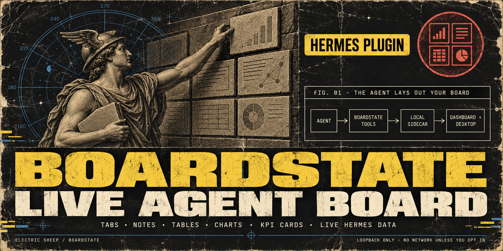
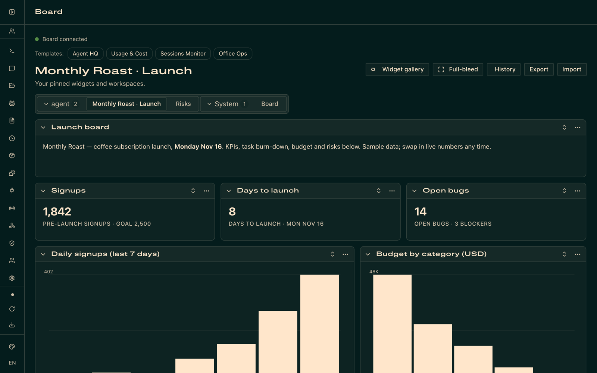
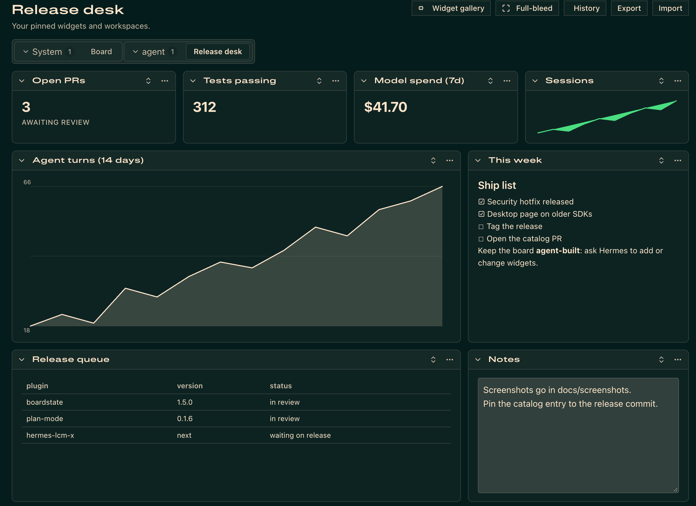
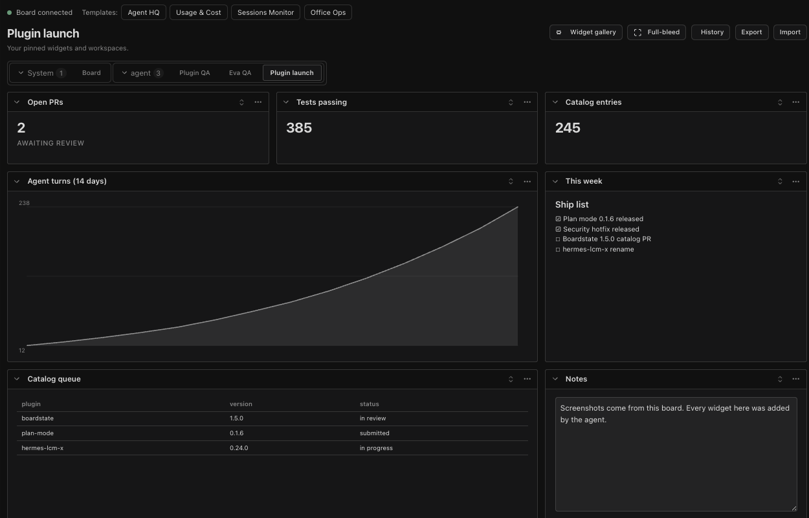

# Boardstate for Hermes



From one ask, your Hermes agent builds a live board of KPIs, tables and charts, and keeps it current as plans change.

**[Watch the demo](https://x.com/ElectricSheepIO/status/2120139551293292623)**

[](https://github.com/100yenadmin/boardstate-hermes-plugin/releases/latest)
[](LICENSE)
[](https://github.com/NousResearch/hermes-agent)
[](https://github.com/100yenadmin/boardstate-hermes-plugin/actions/workflows/ci.yml)



## Install

```bash
hermes plugins install 100yenadmin/boardstate-hermes-plugin --enable
```

This installs the current `main` branch; to install one exact release, pin it (see
[More install options](#more-install-options)). You need Hermes 0.21.2 or newer and Node.js 20 or newer.
No API keys or accounts. Hermes prints a "custom (unreviewed) source" warning for any install from a
repository; Boardstate scans `safe`, so it installs with no prompt. Then start (or restart) `hermes dashboard`
and follow **Try it** below.

The catalog name also works, but it can give an older release:

```bash
hermes plugins install boardstate --enable
```

On Hermes 0.23.0 that line installs 1.5.2, because 0.23.0 falls back to the catalog copy it shipped with
([NousResearch/hermes-agent#151856](https://github.com/NousResearch/hermes-agent/issues/151856)). Use the
first line for the current version.

## Try it

1. **Open the board.** Start `hermes dashboard` and open the **Board** tab. In Hermes Desktop, switch on
   **Boardstate** under **Capabilities → Plugins** and open the **Board** page. The Web tab and the Desktop
   page have separate switches.
2. **Ask your agent** for a board, for example: "Make me a launch board for a coffee subscription app
   shipping Friday: KPIs for signups and days to launch, a task table with owners, a budget chart, a risks
   list, and live usage of this agent. Use sample numbers."
3. **Watch it appear.** KPI cards, the task table, the chart, the risks list and a live usage panel land on
   the board as the agent's `boardstate_*` tool calls run. Then say "Launch slipped to Monday. Update the
   board." The same widgets change in place.

## What you get

- **Where it shows:** a **Board** tab in the Hermes web dashboard, a **Board** page in Hermes Desktop, and
  19 native agent tools (`boardstate_*`). An optional MCP endpoint is there for other clients.
- **Widgets:** notes, markdown (tables included), tables, charts, KPI cards, live Hermes data (sessions,
  usage, cron jobs, running instances) and approvals. Starter templates: Agent HQ, Usage & Cost, Sessions
  Monitor and Office Ops.
- **It is saved:** the board is a validated document in your Hermes home, with undo, history, export and
  import. It survives restarts, updates and reinstalls.
- **It is live:** changes from the agent show up live on the open board. Hermes Desktop connected to a
  remote over OAuth has no live socket, so the page says **live updates unavailable**; reload it to see
  changes.
- **Reaching outside Hermes is opt-in:** connectors to local tools or remote MCP servers run only when an
  operator configures them. Their reads need an approved grant, and their actions wait for an operator decision unless the operator
  has set that tool to **Auto-run**.

## How it compares

| | Stock Hermes dashboard | [Home Dashboard](https://github.com/NousResearch/hermes-agent/blob/main/plugin-catalog/home-dashboard.yaml) | [Board](https://github.com/NousResearch/hermes-agent/blob/main/plugin-catalog/hermes-board.yaml) | Boardstate |
| --- | --- | --- | --- | --- |
| What it is | Fixed pages: sessions, analytics, cron, logs, config and more | A home page of draggable, resizable widgets | A Miro-like diagram board: nodes, edges, notes and groups | A board of KPI cards, tables, charts, notes, live Hermes data and approvals |
| Who builds it | Hermes ships it | You arrange it (no agent tools) | The agent, with 7 `board_*` tools; you edit it in a Desktop pane | The agent, with 19 `boardstate_*` tools; you apply templates, type notes and approve actions |
| Where | Web dashboard | Web dashboard and Desktop | Desktop pane, plus PNG export | Web dashboard tab and Desktop page |

Sources: the [Hermes v0.23.0 dashboard pages](https://github.com/NousResearch/hermes-agent/tree/v0.23.0/web/src/pages)
and each plugin's Hermes catalog entry, as of 2026-11-10.

## Settings

Boardstate needs no configuration. These are the settings an operator can change:

| Setting | Default | What it does |
| --- | --- | --- |
| `HERMES_NODE_BIN` | unset | The Node.js 20+ binary for the sidecar. When it is unset, Boardstate uses Hermes' own Node lookup, then `PATH`. |
| `BOARDSTATE_HERMES_STATE_DIR` | `boardstate-state` in the profile's Hermes home | Where the board is stored (see [Uninstall](#uninstall)). |
| `boardstate.connectors.json` in the state directory | absent: no connectors | Operator-authored external connectors (see [Connector configuration](#connector-configuration)). |
| `boardstate.operators.json` in the state directory | absent | Who may approve actions on a dashboard behind an auth gate. Without it, approvals there are refused. See [docs/connectors/officecli.md](docs/connectors/officecli.md#multi-user--gated-dashboards). |

## More install options

To install one exact release, pin its commit:

```bash
hermes plugins install 100yenadmin/boardstate-hermes-plugin --ref <40-character commit sha> --enable
```

Each [release](https://github.com/100yenadmin/boardstate-hermes-plugin/releases) names its commit sha. `--ref` takes a full sha, not a tag. Hermes scans
this install as a community source. Every release since 1.5.4 scans `safe` on Hermes 0.23.0, so it installs
with no prompt and no `--force`, including from Hermes Desktop and scripts. CI runs that scanner on every
commit and fails on anything that would not scan `safe` (see
[docs/security-scanner.md](docs/security-scanner.md)). 1.5.3 and earlier scan `caution`.

If Boardstate is already installed, for example at an older catalog pin, remove it first. The board stays
in `boardstate-state` (see [Uninstall](#uninstall)). Then run an install line again:

```bash
hermes plugins remove boardstate
```

`hermes plugins update boardstate` moves a catalog install only as far as the catalog pin, which on Hermes
0.23.0 can be the older copy Hermes shipped with. It moves an unpinned repository install to the latest
commit on `main`, and leaves a `--ref` install where it is.

To enable an installed copy later:

```bash
hermes plugins enable boardstate
```

After you update or reinstall the plugin, quit and reopen Hermes Desktop. **Rescan** under
**Capabilities → Plugins** copies the new Desktop files, but a Desktop plugin that is already loaded keeps
running its old code until the app restarts.

### Profiles

On Hermes 0.21.x, `hermes -p <name> dashboard` re-runs as the default profile with
`--open-profile <name>`. Web dashboard plugins load from the root `~/.hermes/plugins`, and
their state comes from the dashboard process's `HERMES_HOME`, so the web **Board** tab shows
the default profile's board. Install with `hermes plugins install …` (no `-p`) for the
dashboard, and with `hermes -p <name> plugins install …` for that profile's agent tools. Hermes
Desktop loads the Desktop half app-wide from `~/.hermes/desktop-plugins` once you switch it
on under **Capabilities → Plugins**, and talks to the active profile's backend.

### Uninstall

Run `hermes plugins remove boardstate`. The board itself stays in the `boardstate-state`
directory of the profile's Hermes home: `$HERMES_HOME` when you set it, otherwise `~/.hermes` for
the default profile and `~/.hermes/profiles/<name>` for a named profile. If you set
`BOARDSTATE_HERMES_STATE_DIR`, the board is in that directory instead. Delete it if you no longer
need the board.

## Native agent tools

No hand-written `mcp_servers` entry is needed. The package registers these 19 tools in the
`boardstate` toolset:

- `boardstate_workspace_get`
- `boardstate_tab_create`, `boardstate_tab_update`, `boardstate_tab_delete`,
  `boardstate_tabs_reorder`
- `boardstate_widget_add`, `boardstate_widget_update`, `boardstate_widget_move`,
  `boardstate_widget_remove`
- `boardstate_layout_set`, `boardstate_workspace_replace`, `boardstate_undo`
- `boardstate_widget_catalog`, `boardstate_design_review`,
  `boardstate_widget_scaffold`, `boardstate_data_read`
- `boardstate_tool_search`, `boardstate_connector_read`,
  `boardstate_connector_invoke`

`boardstate_workspace_get` also returns what the user typed into each Notes card, read-only,
as `notes` beside the document, so the agent can read and act on it. A Notes card that nobody
has typed in has no entry.

The two connector invocation tools and `boardstate_tool_search` are always discoverable.
Without an operator-authored connector configuration they return a clear
`no connectors configured` error.

The existing Streamable HTTP MCP endpoint remains available as an optional compatibility
path at `/api/plugins/boardstate/mcp`, but normal Hermes use should rely on the native tools.

## What runs

Boardstate starts one Node sidecar on an ephemeral `127.0.0.1` port. Every spawn gets a
random nonce. Its mode-0600 port record contains the port, nonce, process id, and owner
kind so the agent and dashboard do not create competing writers.

- An agent tool call can start the sidecar without the dashboard. That sidecar gets no
  operator secret at all, so operator-only verbs are unavailable until the dashboard
  replaces it. On it, `boardstate_connector_invoke` still runs approved readOnly connector
  tools; a mutating tool asks the agent to open the Board tab instead of parking.
- When the dashboard finds an agent-owned sidecar, it terminates and replaces that process
  with a dashboard-owned one. Both use the same state directory, so the board survives.
- An agent-owned sidecar is stopped when its owner exits if no live agent process adopted
  it. A process never stops a sidecar whose port record has moved to another spawn.
- If every process named in the sidecar's port record (its owner and any adopters) dies
  without cleaning up, for example after `SIGKILL`, the sidecar notices within a few seconds
  and shuts itself down.
- Live Hermes data widgets use the authenticated dashboard API. When only the agent half is
  running, they show an explicit "open the Board tab" unavailable message instead of
  crashing.

The Desktop plugin stays inside the public plugin SDK. It uses `ctx.register` with
`ROUTES_AREA` and `SIDEBAR_NAV_AREA` for the page and its nav row, `ctx.rest` for Boardstate
requests, `ctx.socket` for server pushes, `ctx.onDispose` for cleanup, `ctx.setTimeout` when
the SDK provides it (with a disposed fallback timer on older SDKs), and `host.notify` for
template errors.
OAuth remotes support request/response traffic but the SDK intentionally provides no live
socket there, so the page reports **live updates unavailable** instead of pretending to be
live.

## Network and security disclosure

Boardstate makes no third-party network request by default.

- The sidecar, dashboard bridge, native tool wrapper, and optional MCP path communicate on
  loopback only. Live Hermes widgets call the local Hermes dashboard API.
- External connectors are opt-in. Only an operator-authored
  `$HERMES_HOME/boardstate-state/boardstate.connectors.json` can enable one. A connector may
  spawn its configured local command or contact its configured remote MCP URL; those are
  the only runtime paths that can reach outside Hermes.
- Connector reads require an approved grant. Connector mutations park for an operator
  decision. A changed connector manifest re-pends its grant. A mutation whose wait times out
  is reported as parked, but a later confirm can still run it, so the agent is told not to
  retry it on its own (a retry can run the mutation twice) and to ask the operator for the outcome.
- Operator approve/confirm/deny verbs use a separate in-memory secret that is never written
  to the port record. In gated multi-user mode, `boardstate.operators.json` is also required.
- Sidecar traffic never goes through an `HTTP(S)_PROXY` from the environment.
- The sidecar inherits the Hermes process environment, so provider keys there are available
  to connector `env` references. A dashboard-owned sidecar also receives the dashboard session
  token so live Hermes data widgets can read the local dashboard API.
- **Limit of the operator gate.** It keeps approvals off the agent's tool surface: no
  `boardstate_*` tool, MCP call or board WebSocket can approve or confirm anything. It is not
  a boundary against an agent that has unrestricted shell access as the same OS user. In
  ungated loopback mode, such an agent can read the dashboard page, which carries the
  dashboard session token. In any mode, it can read a same-user process's environment,
  including the dashboard-owned sidecar's operator secret. If approvals must hold against the
  agent itself, run the agent's terminal in an isolated backend (for example Docker, SSH or
  Modal) or as a different OS user from the dashboard.
- Text typed into a Notes card is visible to the agent: `boardstate_workspace_get` returns it
  read-only, like the rest of the board. Keep secrets out of Notes cards.
- Approved custom widgets run in an opaque-origin iframe with a no-network Content Security
  Policy. Pending, rejected, and unknown widget assets all return 404.

## Connector configuration

Connectors are optional. For example, after installing OfficeCLI, an operator can create:

```json
{
  "connectors": [
    { "name": "officecli", "transport": "stdio", "command": "officecli", "args": ["mcp"] }
  ]
}
```

Save that as `$HERMES_HOME/boardstate-state/boardstate.connectors.json`, restart the
dashboard, and approve only the requested tools you want. See
[docs/connectors/officecli.md](docs/connectors/officecli.md).

Connector grants are scoped to the active Hermes profile: Boardstate keeps separate state for
each `HERMES_HOME`/profile, while sessions within one profile are the same agent and
intentionally share native-tool grants.

## Security scanner

On Hermes 0.23.0 the install-time scan reports `safe`, and CI runs that scanner on every commit. What each
remaining informational finding is, and how the build keeps it that way:
[docs/security-scanner.md](docs/security-scanner.md).

## Development and tests

The build produces the Web bundle, root `desktop/plugin.js`, sidecar bundle, vendored Lit
assets, and `dashboard/tools.schema.json`. The schema is generated from the same Boardstate
tool factory and connector definitions the sidecar invokes.

CI keeps the existing sidecar, connector, operator, widget, theme, Web, Desktop, and Python
tests. It also pins Hermes upstream commit
`38c289c0146ed8c8b2b767eca1fff6f5b7e6382e` and runs plugin validate, doctor, compat,
native-tool dispatch, WebSocket auth, and the schema sync gate.

## Screenshots

A board built by the agent through the native tools, in the Web **Board** tab:



The same kind of board on the **Board** page in Hermes Desktop:



## Troubleshooting and reporting a bug

Boardstate has no agent-callable diagnostics tool yet. Collect recent logs with
`hermes logs gui -n 300 | grep -i boardstate` (dashboard), `hermes logs desktop -n 300 | grep -i boardstate` (Desktop), or
`hermes logs -n 300 | grep -i boardstate` (agent tools); remove tokens, credentials, private data, and local paths.
In a browser tab where you are already signed in to your local Hermes dashboard, open `/api/plugins/boardstate/health` and check the browser console.
The probe reports `ok`, `sidecar_running`, `sidecar_port`, `state_dir`, and `bundle_present`; leave `state_dir` out of the report. Don't copy session tokens or call the endpoint or the gateway by hand with credentials.
On Hermes 0.21.6 or newer, ask your Hermes agent to "report a problem with Boardstate". On older versions, ask it to load the `boardstate:boardstate-report-problem` skill. Either way, review its draft before it is filed.
Use the [bug report form](https://github.com/100yenadmin/boardstate-hermes-plugin/issues/new?template=bug_report.yml).
Report security problems through a [private advisory](https://github.com/100yenadmin/boardstate-hermes-plugin/security/advisories/new).

## Links

- [Releases](https://github.com/100yenadmin/boardstate-hermes-plugin/releases) and the [CHANGELOG](CHANGELOG.md)
- [Contributing](CONTRIBUTING.md) and the [security policy](SECURITY.md)
- [Bug report form](https://github.com/100yenadmin/boardstate-hermes-plugin/issues/new?template=bug_report.yml)

## License

MIT — see [LICENSE](LICENSE).
